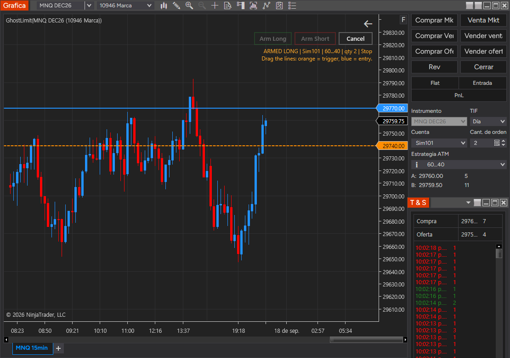

# GhostLimit

**A resting order that isn't on the book.** A NinjaTrader 8 indicator: drag a trigger line and an
entry line onto your chart, arm it, and nothing is sent to the exchange. The moment price *touches*
the trigger, GhostLimit submits the real Stop or Limit entry with your native ATM template —
stop and target in place instantly.

**[Buy GhostLimit — launch price 129 USD →](https://buy.stripe.com/28EaEXe7d0t7d4zg0AaEE00)**
&nbsp;·&nbsp; launch price for the first 20 licenses, 250 USD afterwards · lifetime license ·
installer + manual (Spanish) · [Español ↓](#español)

## Why it exists

A conventional limit order fills at the first touch — usually mid-push, right before the move that
takes out your stop — and while it sits on the book the whole market can see it. What worked for me
was waiting for price to *tap* a level (a VWAP, a prior high) and entering on the way back. Doing that
by hand means staring at the screen with the mouse over the DOM. GhostLimit is that pattern as an
indicator.

## How it works

| | |
|---|---|
| **Trigger line** (orange, dashed) | the price that wakes the order up |
| **Entry line** (blue) | where the order is actually placed |
| **Entry type** | `Stop` or `Limit` |
| **Account · ATM · quantity** | whatever is selected in Chart Trader when you press Arm (snapshotted) |
| **Brackets** | always your native NinjaTrader ATM template |
| **Lifecycle** | one shot per arm: `DISARMED → ARMED → TRIGGERED → POSITION OPEN → DISARMED` |

**Fail-closed by design.** If the order would be invalid or immediately marketable at the instant of
the trigger, nothing is sent and the banner says why. It never cancels orders that aren't its own,
never fires on historical data, allows one armed trade at a time and caps size at 1–20 contracts.

It is **not** a bot or a signal service: you choose the level and you arm every trade.

## What you get

- One-file **installer** for NinjaTrader 8 (Windows) that checks your setup and installs it.
- **License per computer**, delivered automatically after payment (2 activations, e.g. if you change PC).
- Installation and user **manual** in Spanish.

Requirements: NinjaTrader 8 on Windows, Chart Trader open, a saved ATM template, real-time data.

## Contact

Kevin García · [kevin.garcia.quant@gmail.com](mailto:kevin.garcia.quant@gmail.com) ·
[LinkedIn](https://www.linkedin.com/in/kevingarcia-quant)

> GhostLimit is an execution tool for NinjaTrader 8: it gives no signals and guarantees no results.
> Trading futures involves risk of loss. Try it on a simulation account first.

---

## Español

**Una orden en reposo que no está en el libro.** Un indicador para NinjaTrader 8: arrastras una línea
de gatillo y una de entrada sobre tu gráfica, armas, y no se manda nada al mercado. En el momento en
que el precio *toca* el gatillo, GhostLimit envía la entrada real —Stop o Limit— con tu plantilla ATM:
el stop y el objetivo quedan puestos al instante.

**[Comprar GhostLimit — precio de lanzamiento 129 USD →](https://buy.stripe.com/28EaEXe7d0t7d4zg0AaEE00)**
— precio para las primeras 20 licencias; después, 250 USD. Licencia de por vida para tu computadora,
instalador de un solo archivo y manual en español. Al pagar te llega por correo la descarga y el
enlace para activar tu licencia.

**Cómo funciona.** Línea de gatillo (naranja, punteada): el precio que despierta la orden. Línea de
entrada (azul): donde se coloca de verdad. Cuenta, ATM y cantidad: lo que tengas en el Chart Trader al
pulsar Arm. Hasta que el precio no toca el gatillo, no existe ninguna orden en el mercado.

**Diseñado para ser desconfiado.** Si la orden no tiene sentido en el momento del disparo, no manda
nada. Nunca cancela órdenes que no sean suyas. No dispara con datos históricos. Una sola operación
armada a la vez y tope de 1 a 20 contratos. No es un bot ni un sistema de señales: tú decides el nivel
y tú armas cada operación.

**Requisitos.** NinjaTrader 8 en Windows, Chart Trader abierto, una plantilla ATM guardada y datos en
tiempo real.

> GhostLimit es una herramienta de ejecución para NinjaTrader 8: no da señales ni garantiza
> resultados. Operar futuros implica riesgo de pérdida. Pruébalo primero en una cuenta de simulación.

© 2026 Kevin García. GhostLimit es software comercial; todos los derechos reservados.
